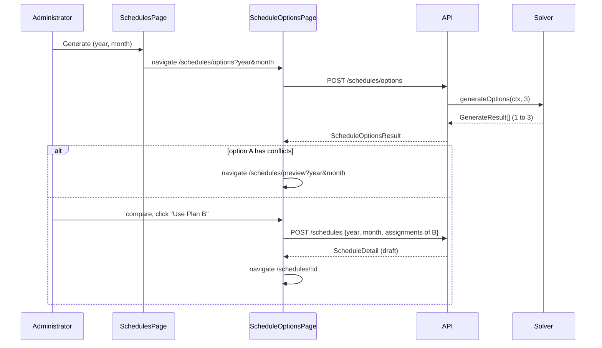

# Schedule Options (3 Plans per Generate) - Implementation Plan

Branch: `multiple_Schedules`. The implementing agent commits on this branch (AGENTS.md: never on `main`).
Status and decisions log: `todos/schedule-options-status.md`. Create it in Task 0 and update it after every task.

## Goal

When an administrator clicks **Generate** on the Schedules page, the system computes up to **3 different
schedule options** for the month. The administrator compares them side by side and picks one. Only the
picked option is saved, as a draft schedule, through the existing `POST /schedules` path.

Note: only administrators can generate (`auth.isAdmin`, `authorize('administrator')`). "Doctor" in the
request means the administrator user. Doctors keep read-only access.

## Vocabulary (use these terms everywhere)

| Term | Meaning |
|---|---|
| schedule option | One complete candidate schedule for a month. Code: `option`. UI label (en): "Plan A / Plan B / Plan C". |
| primary option | Option A: the result of the existing lexicographic solve (same as today's `generate`). |
| alternative | Options B and C, computed after the primary option. |
| plan | Keep the existing meaning only: `GenerateAssignment[]` sent by the client (`validatePlan`, `currentPlan`). Do not use "plan" for options in code. |

## Design decisions

| Code | Decision | Reason |
|---|---|---|
| D1 | Alternatives are **equally optimal**: every stage optimum of the primary solve (cover, relax, weekdays, share, holidays, fill) is kept as a bound row. | All 3 options respect the same hard rules and the same fairness quality. The administrator chooses on preference, not on quality. |
| D2 | Each alternative is **as different as possible**: objective = minimize the overlap with all earlier options (sum of `x` over cells chosen in earlier options), plus one no-good row per earlier option (`sum of its chosen x <= size - 1`). | Guarantees distinct options and avoids options that differ by a single swap when larger differences exist. |
| D3 | Fewer than 3 options is a valid result. An alternative stops the chain when its model is `Infeasible` (no other equally optimal schedule exists) or when no incumbent is found in its budget. | Some months have a unique optimum. Showing a weaker plan would break D1. |
| D4 | Alternatives run only when the primary option is `optimal`. If the primary option stopped at the time limit or used the greedy fallback, return 1 option. | Without proven optima there are no bounds, so D1 cannot hold. |
| D5 | Determinism stays: the same input gives the same 3 options in the same order (fixed `SOLVE_OPTIONS`, deterministic names). | Matches the existing D5 of the solver design. Reload of the page gives the same options. |
| D6 | Budget: primary keeps `SOLVER_BUDGET_MS = 10_000`. New `ALTERNATIVE_BUDGET_MS = 5_000` **per alternative**, own deadline set when that alternative starts. Worst case about 20 s. | Bounded wait. An incumbent found at the time limit still satisfies every bound row (D1), so it is accepted. |
| D7 | No database change. Options are not persisted. The chosen option is saved with the existing `POST /schedules` body `{ year, month, assignments }`. | `validatePlan` already re-checks every hard rule server-side, so a client cannot save an invalid option. `docs/database.md` stays unchanged. |
| D8 | New endpoint `POST /schedules/options` (administrator only), read-only like `POST /schedules/preview`. Returns 409 when a schedule for that clinic and month already exists, before any solve. | Avoids a 20 s solve that cannot be saved. |
| D9 | Duty reasons of alternatives use the same format as the primary option (`solver optimal; first friday` etc.). | They are optimal on every stage (D1). No change to `apps/web/src/lib/duty-reason.ts`. |
| D10 | If option A has conflicts (short days), the web app routes to the existing preview page, as it does today on the 422 response. All options share the same coverage optimum, so they have the same short days. | Keeps the existing conflict workflow. |
| D11 | The options page owns the request (reload-safe). The Schedules page dialog only validates year and month, then navigates. The progress bar code moves from `SchedulesPage.vue` into a composable. | No cross-route store. A reload re-solves and, by D5, shows the same options. |

## Open decisions (defaults apply if the user gives no steer)

| Code | Question | Default |
|---|---|---|
| Q1 | Activity log `detail.mode` for a saved option is `'manual'` today (any request with `assignments`). Record `'option'` instead? | No change. |
| Q2 | Keep the engine path of `POST /schedules` without `assignments` (now unused by the web app)? | Keep. API scripts and tests still use it. |
| Q3 | Add "Edit in preview" on an option (open the preview page pre-filled with that option)? | Out of scope. |

## Data flow



## Instructions for the implementing agent

- Read `AGENTS.md`, this plan, `docs/superpowers/specs/2026-10-05-scheduling-solver-design.md` and
  `apps/api/src/scheduling/solver-model.ts` (stage order and bound rows) first. Use subagent-driven development.
- No Prettier, no lint rule changes, no GitHub Actions version changes. ASCII only in new code and docs.
- Tests: Vitest, `__tests__/` beside the source, `<name>.test.ts`. Assert aggregates and invariants, not exact
  assignments.
- Before each commit, run the touched workspace's `typecheck`, `lint`, and `test`. At the end, run
  `pnpm typecheck`, `pnpm lint`, and `pnpm test` from the root.
- Do not touch `git stash` entries.

## Task 0 - Status file

Create `todos/schedule-options-status.md` with goal, state, the decision table above (with datetime), and next
steps. Record the defaults taken for Q1-Q3.

## Task 1 - Alternative model (pure)

File: `apps/api/src/scheduling/solver-model.ts`.

1. Add `'alternative'` to the `Stage` union. Do not add it to `index.stages`; the primary chain is unchanged.
2. Extend `ModelBounds` with `avoid?: readonly ReadonlySet<string>[]`: the chosen cell names of every earlier
   option.
3. In `buildModel`, when `stage === 'alternative'`:
   - Treat every stage as reached (all objective blocks are built: weekdays, share, holidays).
   - Emit the existing `bound_<stage>` rows for every minimized stage in `bounds.optima` (`<=`).
   - Emit `bound_fill: sum of all x >= optima.get('fill')`. The current bound loop only handles minimized
     stages; `fill` is maximized, so it needs this separate `>=` row.
   - For each set `j` in `avoid`: row `nogood_<j>: sum of x over set j <= size(j) - 1`.
   - Objective: `Minimize` the sum over all `avoid` sets of their `x` terms (a cell chosen in two earlier
     options gets coefficient 2; merge terms per variable so each variable appears once).
   - Return null when `avoid` is empty or there are no cells.
4. Keep one code path: reuse the existing rule and objective construction; do not copy `buildModel`.
5. Tests (`__tests__/solver-model.test.ts`): for a 3-day context with one avoided set, the LP text contains
   one `nogood_` row with right-hand side `size - 1`, the `bound_fill` row with `>=`, and a `bound_` row for
   each solved stage. Do not snapshot full LP text.

## Task 2 - Solver: `generateOptions`

File: `apps/api/src/scheduling/solver.ts`, `apps/api/src/scheduling/index.ts`.

1. `solveStages` also returns `optima` and `capacity` (it already builds them), so alternatives can reuse them.
   Store the `fill` optimum in `optima` like the others (it is integral).
2. New export `generateOptions(ctx, count, loader = loadSolver): Promise<GenerateResult[]>`:
   - Run the primary chain exactly as `generate` does today, including the greedy fallback.
   - If the primary status is not `optimal` (D4) or `count === 1`, return `[primary]`.
   - For `k = 2..count`: deadline `Date.now() + ALTERNATIVE_BUDGET_MS`; build the `alternative` model with
     `avoid` = chosen sets of all earlier options; solve once.
     - `Optimal`: decode with status `optimal`, add it.
     - Time limit with a finite objective: decode with status `optimal` (D1, D9), add it, continue.
     - `Infeasible`, time limit without incumbent, or budget spent: stop the loop (D3).
     - Any other status or a thrown error: log `warn` with `clinicId`, `year`, `month`, `option: k`, and stop
       the loop. Do not fall back to greedy for alternatives; the primary option is kept.
   - `solveOnce` throws on `Infeasible` today. Let the alternative loop handle `Infeasible` as a normal stop:
     either pass an `allowInfeasible` flag or check the status before calling `solveOnce`. Choose the simpler
     one and record it in the status file.
3. `generate(ctx, loader)` becomes `(await generateOptions(ctx, 1, loader))[0]`. Behavior of `generate` must not
   change (existing `solver.test.ts` stays green without edits).
4. Export `ALTERNATIVE_BUDGET_MS` beside `SOLVER_BUDGET_MS`. Export `generateOptions` from
   `scheduling/index.ts`.
5. Tests (`__tests__/solver.test.ts`, new `describe('solver: options')`):
   - October 2026 fixture, `generateOptions(c, 3)`: 3 results; option 1 deep-equals `generate(c)`; every
     option passes `expectHardRules`; every option has no conflicts, 59 duties, the same Fri/Sat/Sun profile
     as option 1, totals spread <= 1, holiday cap kept; the 3 chosen sets are pairwise different.
   - Determinism: two `generateOptions(c, 3)` runs are deep-equal.
   - Unique optimum: a small context where only one optimal schedule exists (for example one doctor, two
     Saturdays, minimum 1) returns exactly 1 option.
   - Primary at time limit (`timeLimitedLoader(2, true)`) returns 1 option.
   - Failing loader returns 1 option with `; fallback` reasons.
   - Alternative at time limit without incumbent: a loader that reports `Time limit reached` with
     `ObjectiveValue: Infinity` only on the first alternative solve returns 1 option.

## Task 3 - Shared types and schema

Files: `packages/shared/src/types/schedule.ts`, `packages/shared/src/types/index.ts`.

```ts
/** Per-doctor load of one schedule option, for side-by-side comparison. */
export interface DoctorLoad {
  doctorId: number
  doctorFirstName: string
  doctorLastName: string
  total: number
  holiday: number
  friday: number
  saturday: number
  sunday: number
}

/** One candidate schedule; not persisted. `days` is eligibility against this option. */
export interface ScheduleOption extends PreviewResult {
  /** 1-based position; 1 is the primary option. */
  index: number
  /** Dates whose doctor set differs from option 1 (empty for option 1). */
  changedDates: string[]
  loads: DoctorLoad[]
}

export interface ScheduleOptionsResult {
  year: number
  month: number
  options: ScheduleOption[]
}
```

Request body: reuse `createScheduleSchema` (`{ year, month }`). No new Zod schema.

## Task 4 - API service, controller, route

Files: `apps/api/src/services/schedule.service.ts`, `apps/api/src/controllers/schedule.controller.ts`,
`apps/api/src/routes/schedule.routes.ts`, `apps/api/src/validators/schedule.ts` (only if a re-export is needed).

1. Extract the eligibility block that `preview()` repeats twice (`buildDutyMaps` + `seedAdjacentDuties` +
   `computeEligibility`) into one private helper, for example
   `eligibilityFor(ctx, assignments, clinicId): Promise<DayInfo[]>`. Use it in both `preview()` branches and in
   the new function. Behavior of `preview()` must not change.
2. Extract the "schedule already exists" check of `generate()` into a private helper and call it from
   `generate()` and the new function (D8). Same 409 message.
3. New `generateOptions(year, month, scope): Promise<ScheduleOptionsResult>`:
   - Existence check (409), `buildContext`, `runEngineOptions(ctx, SCHEDULE_OPTION_COUNT)` with
     `SCHEDULE_OPTION_COUNT = 3` (import `generateOptions as runEngineOptions` like `runEngine`).
   - Per result: `days` via the helper, `changedDates` (compare the per-date doctor id sets with option 1),
     `loads` for every active doctor in `ctx.doctors` (include doctors with 0 duties; holiday from
     `ctx.days[].isHoliday`; Fri/Sat/Sun from the date's weekday).
   - No activity log entry and no usage metering (read-only, like preview).
4. Controller `options`: thin, same scope resolution as `preview` (`resolveClinicScope`), responds 200 with the
   envelope.
5. Route: `scheduleRouter.post('/options', authorize('administrator'), validate(scheduleQuerySchema, 'query'),
   validate(createScheduleSchema, 'body'), scheduleController.options)`. Register it next to `/preview`, before
   any `/:id` route.
6. Tests:
   - `schedule.service.test.ts`: 409 when the schedule exists and the engine is not run; a mocked context
     returns 1-3 options, option 1 has empty `changedDates`, `loads` lists every active doctor and the sum of
     `total` equals the option's assignment count.
   - `schedule.routes.test.ts`: doctor gets 403; administrator gets 200 with `options`; superadmin without
     `clinicId` defaults to the sole clinic (same pattern as the existing preview/generate test).

## Task 5 - Web service and progress composable

Files: `apps/web/src/services/schedule.ts`, new `apps/web/src/composables/useEstimatedProgress.ts`,
`apps/web/src/pages/SchedulesPage.vue`.

1. `options(year, month): Promise<ScheduleOptionsResult>` posts to `/schedules/options`.
2. Move (cut, not copy) the time-based progress logic from `SchedulesPage.vue` (`ESTIMATED_GENERATE_MS`,
   `PROGRESS_HOLD`, `startProgress`, `finishProgress`, `stopProgress`, unmount cleanup) into
   `useEstimatedProgress(estimateMs)`. It returns `{ progress, start, finish, stop }` and stops on scope
   dispose. Keep the existing comment that explains why the bar holds below 100%.
3. Estimate for options: `SOLVER_BUDGET_MS + 2 * ALTERNATIVE_BUDGET_MS` = 20 000 ms. Define it as a web
   constant with a comment that it mirrors the API budgets (the web app cannot import from `apps/api`).
4. `SchedulesPage.vue` dialog: `runGenerate` validates with `createScheduleSchema` as today, closes the dialog
   and navigates to `/schedules/options?year=<y>&month=<m>`. Remove the progress bar markup and state from this
   page. The button label stays `schedules.generate`.

## Task 6 - Options page

Files: new `apps/web/src/pages/ScheduleOptionsPage.vue`, `apps/web/src/router/index.ts`,
`apps/web/src/components/schedule/DutyCalendar.vue`, `apps/web/src/locales/en.json`,
`apps/web/src/locales/el.json`.

1. Route `schedules/options`, name `schedule-options`, `meta: { roles: ['administrator'] }`, registered before
   `schedules/:id` (same placement as `schedules/preview`).
2. Page behavior:
   - Reads `year` and `month` from the query; invalid values show the same "invalid month" block as
     `SchedulePreviewPage.vue` (reuse its i18n keys).
   - On mount: loads doctors (`doctorService.list()`) and calls `scheduleService.options` with the progress
     bar from `useEstimatedProgress` (spinner + bar, same markup and ARIA as the old dialog).
   - Request guarded by `useLatestRequest`.
   - 409 (schedule exists): show the error and a "Back to schedules" button.
   - Option 1 has conflicts: `router.replace` to `/schedules/preview?year&month` (D10).
3. Layout (top to bottom):
   - Header: month label, "Back to schedules" button.
   - Option switcher: one button per option (`role="tablist"`, buttons `role="tab"`, `aria-selected`), label
     "Plan A/B/C" and a sub-label "N days differ from Plan A" (option 1: "Solver's first choice").
   - Notice when fewer than 3 options: "Only N different best plans exist for this month." (D3)
   - Comparison table: one row per doctor (from `loads`); for each option the columns Total and Holidays, and
     one Fri/Sat/Sun column (`1/1/1` style). Highlight a cell when its value differs from option 1. Reuse the
     `ui/Table*` components.
   - Calendar: `DutyCalendar` in `mode="readonly"` for the selected option (`assignmentByDate` built from its
     `assignments`, `days` from the option). Pass the new `highlightDates` prop (below) with the option's
     `changedDates`.
   - Action: "Use Plan X" button. Opens the existing confirm dialog (`useConfirm` pattern used in
     `ScheduleDetailPage.vue`), then calls `scheduleService.generate(year, month, assignments)` with
     `{ date, doctorId, reason }` from the selected option, then `router.push('/schedules/<id>')`. Disable the
     button while saving. Show server errors (409/422) inline.
4. `DutyCalendar.vue`: add optional prop `highlightDates?: Set<string>`. A highlighted day gets a visible
   ring plus a legend entry "Differs from Plan A"; colour must not be the only signal (add an icon or text
   marker for accessibility). No change when the prop is absent.
5. Locales: add every new key to both `en.json` and `el.json` under a new `scheduleOptions` section. Greek text
   must be real Greek, consistent with the existing `schedulePreview` wording.
6. Tests:
   - `__tests__/ScheduleOptionsPage.test.ts`: renders one tab per option; switching tabs changes the calendar
     content; "Use Plan B" calls `generate` with option B's assignments and routes to the detail page; option 1
     with conflicts routes to the preview page; a 1-option result shows the notice; a 409 shows the error.
   - `__tests__/SchedulesPage.test.ts`: replace the progress/generate tests with: valid input navigates to
     `/schedules/options?year=..&month=..`; invalid input shows the validation error and does not navigate.
     Delete tests that only pinned the removed progress behaviour on this page.
   - `__tests__/useEstimatedProgress.test.ts` (fake timers): holds below 100 until `finish`, then reaches 100
     and resolves.
   - DutyCalendar test (existing file if present): a highlighted date renders the marker; no marker without
     the prop.

## Task 7 - Smoke run

1. `pnpm db:seed:multi`, `pnpm dev`.
2. As an administrator, for the next month of 2 clinics: Generate -> options page shows up to 3 plans,
   switching plans changes the calendar and the highlighted days, the comparison table matches the calendar.
3. Use Plan B -> the draft detail page shows Plan B's duties; publish works as before.
4. Generate again for the same month -> 409 message on the options page.
5. A month with an unfillable day -> redirect to the preview page.
6. Record the measured `POST /schedules/options` times per clinic and the number of options returned in the
   status file. If any clinic returns fewer than 3 options, record why (Infeasible or time limit).

## Task 8 - Docs

1. `docs/admin-manual/manual.html` section 6.4 (Step 3 - Generate): the new options step, what "equally good"
   means (same rules, same fairness), why fewer than 3 plans can appear, and that only the chosen plan is saved.
   Add a screenshot placeholder only if the manual already uses one for every step; otherwise text only.
2. `docs/superpowers/specs/2026-10-05-scheduling-solver-design.md`: add a short section "Alternative options"
   with D1-D6 of this plan.
3. `AGENTS.md`, Scheduling Engine Requirements: one line that generate returns up to 3 equally optimal options
   and the administrator picks one.
4. `docs/database.md`: no change (no schema change). Confirm in the status file.

## Done when

- `POST /schedules/options` returns 1-3 distinct, equally optimal, deterministic options; each one saves
  through `POST /schedules` without a validation error.
- Generate on the Schedules page leads to the options page; the administrator can compare and save any option.
- `generate` and `preview` behave exactly as before (existing tests unchanged and green).
- `pnpm typecheck`, `pnpm lint`, `pnpm test` pass from the root; the smoke run in Task 7 is recorded in the
  status file.
