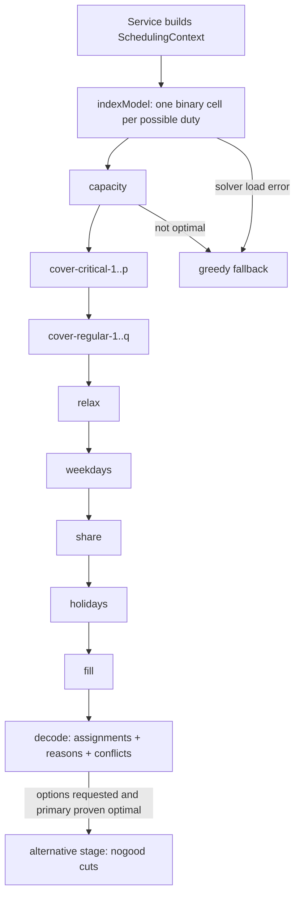

# Solver: How the Schedule Is Calculated

How the scheduling engine computes a month and decides which doctor is placed
on which day. Source of truth: `apps/api/src/scheduling/`.

| File | Role |
|---|---|
| `solver.ts` | Orchestrates the exact solve: stage chain, budgets, fallback |
| `solver-model.ts` | Builds the MIP as CPLEX LP text, one model per stage |
| `highs.ts` | HiGHS (WASM) in a worker thread; one solve at a time |
| `engine.ts` | Greedy fallback engine |
| `conflicts.ts` | Shared eligibility rule (`blockingRule`) and conflict tally |
| `constraints.ts` | Rule constants and single-rule checks |
| `scoring.ts` | Greedy candidate score, Fri/Sat/Sun helper |
| `dates.ts` | Day classification (open, post-open, closed, weekend, holiday) |
| `types.ts` | `SchedulingContext`, `AssignmentPlan`, `ConflictPlan` |

The API never calls the engine files directly. `services/schedule.service.ts`
builds the context and calls `generateOptions()` for `POST /schedules/options`
(up to 3 options, not persisted) and `generate()` for `POST /schedules` (the
administrator's chosen option is saved as a draft).



## 1. Inputs: the `SchedulingContext`

Built per request by `buildContext` in `services/schedule.service.ts`:

| Field | Meaning |
|---|---|
| `days` | Every date of the month with `dayOfWeek`, `isWeekend`, `isHoliday` (weekends plus admin-marked dates) |
| `doctors` | Active doctors with their `maxMonthlyDuties` cap (1-7) |
| `unavailability` | Vacation/absence date ranges per doctor |
| `priorDayDoctorIds` | Doctors on duty on the previous month's last day (cross-month back-to-back) |
| `openDuty` | Open on-call cycle: `anchorDate` + `intervalDays` |
| `slots` | On-call capacity per day type: open / post-open / closed |
| `minimums` | Hard per-day minimum per day type |

## 2. Day classification (`dates.ts`)

Every date gets exactly one type:

- **Open day**: the anchor date and every `intervalDays`-th day after it.
- **Post-open day**: the calendar day right after an open day. The open-day
  duty hands over at 15:00 that day, so it has its own slot count and minimum.
- **Closed day**: everything else.

Derived flags:

- **Critical day** = open day or post-open day. These require double coverage
  and are placed first.
- `slotsForDate` / `minimumForDate` map the day type to its capacity and its
  hard minimum. Any count from the minimum up to the slot count is accepted.

## 3. Rules

Two tiers, shared verbatim by both engines via `conflicts.ts` / `constraints.ts`:

| Tier | Rule | Enforcement |
|---|---|---|
| Hard | Unavailability windows | No duty on a covered date |
| Hard | Monthly cap `maxMonthlyDuties` | Row `cap_<id>` |
| Hard | No back-to-back days (incl. previous month's last day) | Row `b2b_*`; day-1 pruning via `priorDayDoctorIds` |
| Hard | Max 1 open on-call duty per doctor per schedule | Row `open_<id>` |
| Hard | Day slot count | Row `slots_<date>` |
| Soft (fairness) | Holiday cap: max 2 holiday duties per doctor | Relaxable where coverage needs it |
| Soft (fairness) | Max 1 duty per Fri/Sat/Sun weekday per doctor | Relaxable where coverage needs it |
| Target | Every day reaches its minimum | Lexicographic cover stages; short days become conflicts |

The holiday cap in the MIP: non-critical holiday duties `n` satisfy
`n <= max(0, cap - c) + over`, where `c` = critical holiday duties (exempt
from the cap but counted) and `over >= 0` is the relaxation integer minimized
in the `relax` stage. The Fri/Sat/Sun cap works the same: duties on one
weekday minus the repeat integer must stay `<= 1`.

Hard rules are never relaxed. A day left below its minimum by hard rules alone
is reported as a conflict, never silently filled.

## 4. Exact solver: the model (`solver-model.ts`)

### 4.1 One binary per possible duty ("cell")

`indexModel` sorts doctors by id, walks dates ascending, and creates one LP
binary variable per (doctor, day) pair that is still possible:

```
x_<doctorId>_<yyyymmdd>   e.g. x_12_20261005
```

A cell is not created at all when:

- the doctor is unavailable that date, or
- the date is the month's first day and the doctor held the previous month's
  last day (back-to-back across the month boundary is impossible by
  construction, not by a constraint row).

Everything else is a lexicographic MIP over these binaries.

### 4.2 Lexicographic stages: how doctors get placed

The solver does not weigh all goals in one objective. It solves one stage at a
time, in fixed priority order, and after each stage adds a bound row that
freezes that stage's optimum. A later stage can only choose among schedules
that keep every earlier stage optimal.

| Priority | Stage | Minimizes / maximizes |
|---|---|---|
| 0 | `capacity` | - (see below) |
| 1 | `cover-critical-<p>` | Critical days with fewer than `p` on-call doctors |
| 2 | `cover-regular-<p>` | Regular days with fewer than `p` on-call doctors |
| 3 | `relax` | Number of fairness-cap relaxations (holiday overages + Fri/Sat/Sun repeats) |
| 4 | `weekdays` | Doctors missing their first Friday / Saturday / Sunday duty |
| 5 | `share` | Deviation from each doctor's capacity-weighted fair share |
| 6 | `holidays` | Holiday-duty spread between doctors (above 1) |
| 7 | `fill` | - (maximizes total duties, fills optional slots) |

**Positions.** "Positions" are literal in the model: for each day the model
creates positions `p = 1 .. minimum` with the binary `u_<date>_<p>` ("this day
has fewer than `p` doctors") and the row `sum(cells) + p * u >= p`. The stage
`cover-critical-1` minimizes how many critical days have no doctor,
`cover-critical-2` minimizes how many have fewer than two (only created when
some critical minimum is 2 or more), then `cover-regular-1` gives every regular
day its first doctor before `cover-regular-2` gives any day a second, and so
on. This is exactly how the solver "places doctors in positions": coverage
position by coverage position, critical days before all regular days.

**Capacity stage.** Maximizes total assigned cells under per-doctor rules only
(no day rows yet). Because those rules do not couple doctors, the result is
each doctor's own ceiling: the most duties they could take given availability,
monthly cap, open-duty cap, and the caps above. These capacities are not saved
as duties; they are only weights for the `share` stage.

**Share stage.** With `E = sum` of positive capacities and `t_d` = doctor d's
duty count, the rows `fshi_<d>` / `fslo_<d>` enforce
`|E * t_d - cap_d * total| <= E - 1 + dev` and the stage minimizes `dev`.
So each doctor lands within `(E - 1) / E` duties of their capacity-weighted
fair share of the month's total. Doctors whose own limits give capacity 0 are
excluded: their limits lower their own share instead of pulling everyone else.

**Holidays stage.** `hmin` / `hmax` track the smallest and largest holiday
duty count across doctors; `hmax - hmin - hex <= 1` and the stage minimizes
`hex`. An even split is enforced when holiday duties divide evenly; otherwise
the spread stays at 1.

**Fill stage.** Maximizes total assigned cells: fills the optional slots
between a day's minimum and its slot count once every fairness goal is as good
as it can get.

### 4.3 Decoding the solution (`decode` in `solver.ts`)

Cells with `Primal > 0.5` become assignments. Every assignment persists a
`reason`, built from the solve status plus placement notes:

| Reason fragment | Meaning |
|---|---|
| `solver optimal` | The full stage chain proved optimality |
| `solver time limit` | An incumbent kept after the budget ran out mid-chain |
| `first friday` / `first saturday` / `first sunday` | The doctor's only duty on that weekday this month |
| `repeat weekday to reach minimum` | An extra Fri/Sat/Sun duty that coverage needed |
| `day-fill guarantee overrode fairness caps` | A non-critical holiday duty beyond the cap that coverage needed |

A day still below its minimum produces a `ConflictPlan`: date, required
minimum, assigned count, and a tally counting, for every doctor, the first
`blockingRule` that keeps them off that day (`unavailable`, `atMonthlyCap`,
`atOpenDutyCap`, `atHolidayCap`, `backToBack`, `alreadyOnDuty`). The tally is
computed with fairness relaxed, mirroring the last thing the solver would have
tried. The service layer refuses to persist a schedule with short days (422).

### 4.4 Alternative options

`POST /schedules/options` asks for up to 3 schedules. An alternative stage
rebuilds the model with:

- a bound row per stage (the `fill` bound is `>=` because `fill` maximizes),
  so the alternative is exactly as good as the primary option, and
- a no-good cut per earlier option (`sum of its cells <= |cells| - 1`).

The objective minimizes the overlap with earlier options, so each alternative
differs from the previous ones as much as possible while remaining equally
optimal. Alternatives are attempted only when the primary solve was proven
optimal; each gets its own budget and a failed or infeasible solve just ends
the chain, keeping the options found so far.

### 4.5 Budget and fallback

- `SOLVER_BUDGET_MS` (10 s) covers all stages of the primary solve; each
  alternative gets `ALTERNATIVE_BUDGET_MS` (5 s).
- The `capacity` stage must finish `Optimal`; otherwise the whole exact solve
  is abandoned. An objective stage that hits the time limit keeps its incumbent
  and ends the chain; with no incumbent the exact solve is abandoned.
- Abandonment (solver load error, crash, infeasible within budget) falls back
  to the greedy engine; every greedy reason gets a `; fallback` suffix so
  proven-optimal and fallback schedules are distinguishable in the data.
- HiGHS runs in a worker thread (`highs.ts`): one solve at a time from a FIFO
  queue, per-solve time limit derived from the shared deadline, a +5 s watchdog
  for a stuck worker, and a fresh worker after a WASM error.

## 5. Greedy fallback engine (`engine.ts`)

Same rules, different decision procedure: one pass per coverage slot, in fixed
order, never revisiting a choice.

Pass order:

1. Critical days, required slots (up to each day's minimum)
2. Regular days, required slots (up to each day's minimum)
3. Critical days, optional slots (up to slot count)
4. Regular days, optional slots (up to slot count)

Within a pass, days are visited chronologically and each picks exactly one
doctor. Required slots that stay empty become conflicts; optional slots are
best-effort, so a doctor spent on an optional slot can never cost another day
its minimum.

Eligibility per candidate is `blockingRule` (Section 3, in its fixed order).
The winner is the best score from `scoring.ts`:

| Component | Formula | Weight |
|---|---|---|
| `workload` | `(maxMonthlyDuties - duties so far)` | 3 |
| `weekend` | `max(0, ceil(weekendSlots / doctors) - weekend duties so far)`, weekend days only | 4 |
| `friday` | `max(0, ceil(fridaySlots / doctors) - friday duties so far)`, Fridays only | 2 |
| `friSatSun` | 5 if this is the doctor's first duty on this Fri/Sat/Sun weekday | 5 |

Tie-breaks, in order: fewer total duties, fewer weekend duties, lower doctor
id. The persisted reason records the full score breakdown and which tie-break
decided, e.g. `score 15 (workload +9, weekend +4, friday +2, first fri/sat/sun
+0); tie-break: fewer duties`.

Day-fill guarantee: if no doctor is eligible for a required slot on a regular
day, the fairness caps (holiday cap) are relaxed and the pool is retried once;
the reason notes `day-fill guarantee overrode fairness caps`. Hard rules are
never relaxed. Critical days skip fairness caps from the start.

## 6. Determinism

Same input, same schedule:

- Doctors sorted by id, dates ascending; LP rows and names deterministic.
- HiGHS runs with `threads: 1`, `random_seed: 0`, `mip_rel_gap: 0`.
- Greedy has no randomness: fixed pass order and total-ordered comparisons.

## 7. Cross-month correctness

- Back-to-back into the new month: `priorDayDoctorIds` (duty holders of the
  previous month's last day, any schedule status) removes day-1 cells for
  those doctors and the greedy engine checks the same set.
- Back-to-back out of the month is not the generator's concern; the service
  re-checks it when duties are later added or reassigned manually.
- Open-day cycles use pure date math against the anchor, so open, post-open,
  and critical classification stay correct across month boundaries.

## 8. Tests

`apps/api/src/scheduling/__tests__/` mirrors the engine. `engine.test.ts` runs
the same outcome rules against both engines (solver and greedy);
`solver.test.ts` additionally asserts hard rules duty by duty with the
production rule helpers and uses the captured `fixtures/october-2026` clinic
for full-month solves, time-limit behavior, and fallback paths.
